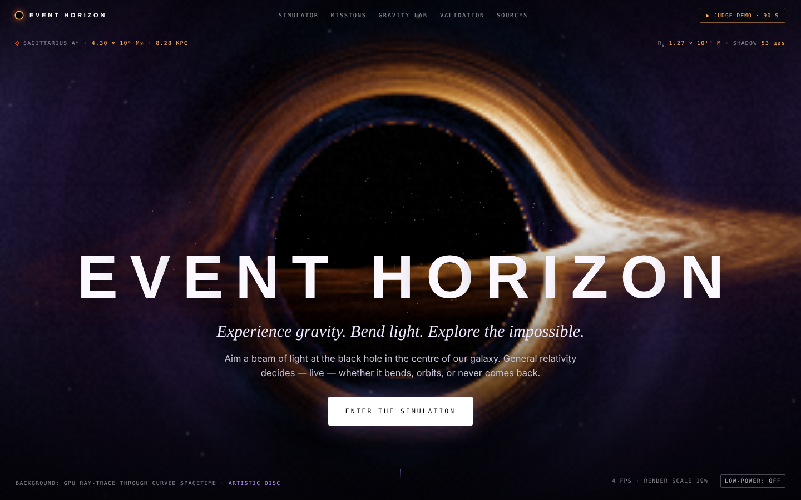
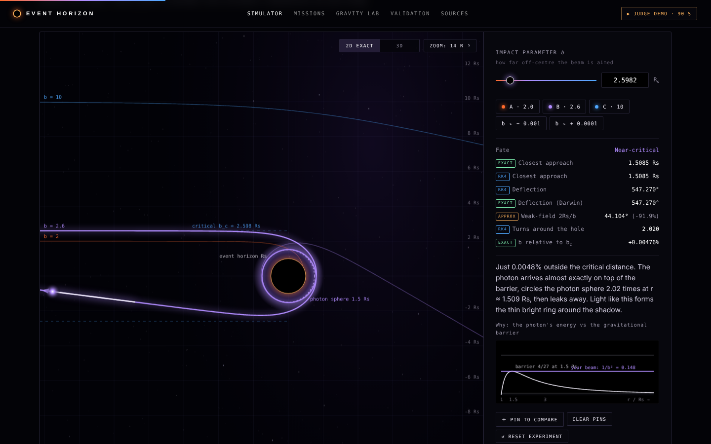
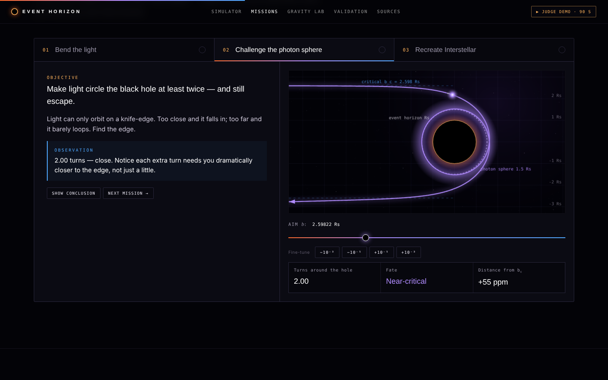
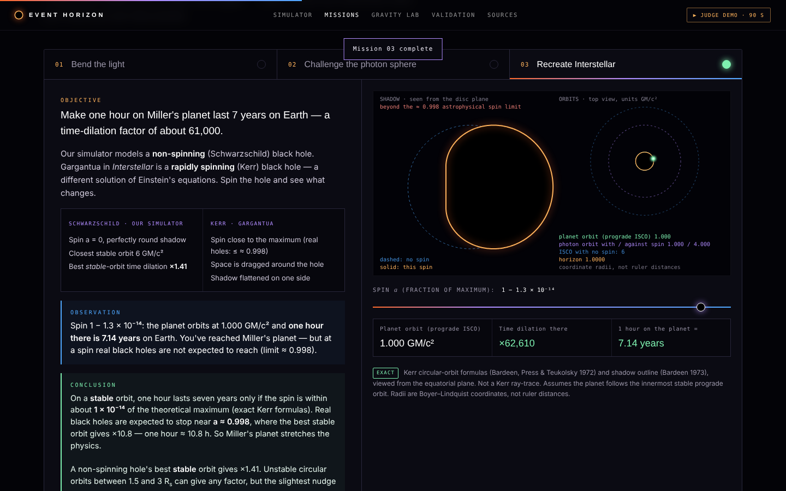
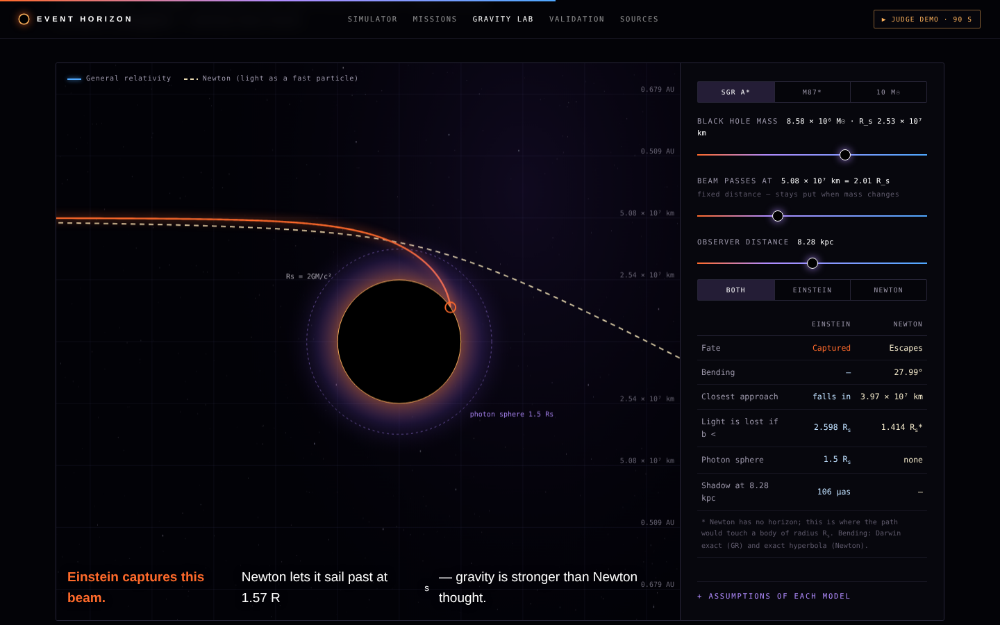

# EVENT HORIZON
### Experience gravity. Bend light. Explore the impossible.

Aim a beam of light at Sagittarius A*. General relativity decides, computed live, whether it bends, orbits or never comes back.

Built for **ENDURANCE · Track: Black Hole Visualizer** (Equinox – The Space Club).



| Simulator | Photon-sphere mission |
|---|---|
|  |  |
| **Interstellar mission** | **Gravity Lab** |
|  |  |

## The experience
1. **Cinematic intro.** A GPU ray-traced black hole with one call to action.
2. **What is happening to light?** Three computed beams and three sentences.
3. **The simulator.** Drag the impact parameter and watch the path, fate, closest approach, deflection and the "why" (an effective-potential chart) update in real time. Pin paths to compare, or switch to 3D.
4. **Mission: cross the event horizon.** Three goal-based experiments:
   - bend light past 90°;
   - make light orbit twice and escape;
   - spin the black hole until one hour lasts seven years (exact Kerr formulas).
5. **Gravity Lab.** Newton vs Einstein for a fixed beam as the black hole's mass changes.
6. **Validation.** 31 checks executed in the browser, the same file as `npm test`.

**Judge demo:** press **▶ Judge demo** in the nav (or open `/#demo`). It runs a 90-second guided tour using the real controls. Space pauses, ← → change step, Esc exits.

## Run locally
```bash
node server.js        # http://localhost:8080  (Node 18+, no npm install needed)
npm test              # 31 validation checks
npm run report        # regenerates VALIDATION.md from a live run
```

## Deploy to Netlify
Drag the **`public`** folder onto https://app.netlify.com/drop, or connect the repo (`netlify.toml` publishes `public/`). There is no build step and nothing to install. Three.js is served locally from `public/vendor/`.

The project also deploys to Vercel (`vercel.json`), Render (`render.yaml`), Docker (`Dockerfile`) or any static host.

## How every number is labelled
| Label | Meaning |
|---|---|
| **EXACT** | Closed-form result: R_s, b_c, shadow, closest approach, Darwin's deflection, Kerr orbits |
| **RK4** | 4th-order Runge–Kutta on d²u/dφ² + u = 3Mu² (step 0.002 rad, launched from 10⁶ M) |
| **APPROX** | Weak-field 2R_s/b and the 4th-order series, shown with their error |
| **OBS** | Prediction vs EHT measurement (1σ) |

## Structure
```
public/
  index.html          single page, seven parts
  css/style.css
  js/physics.js       ALL physics (RK4, exact Darwin, Newton, Kerr, constants, formatting)
  js/tests.js         validation suite (browser + Node)
  ../docs/screenshots  images used in this README
  js/view.js          2D trajectory renderer shared by simulator, missions, lab
  js/app.js           simulator, missions, Gravity Lab, validation UI
  js/demo.js          90-second judge demonstration
  js/raytracer.js     GPU lensing shader (visual layer)
  js/hero.js          hero camera, dust particles
  js/observatory.js   Three.js 3D view (loaded on demand)
  vendor/             three.js r160 + OrbitControls (MIT)
server.js             zero-dependency static server
test/suite.test.js    runs public/js/tests.js under node:test
scripts/report.js     writes VALIDATION.md
AUDIT.md              what was wrong in v2 and what changed
VALIDATION.md         latest validation report
```

## Key sources
EHT Collab. 2022 (ApJL 930 L12); GRAVITY Collab. 2022 (A&A 657 L12); EHT Collab. 2019 (ApJL 875 L1); Darwin 1959; Keeton & Petters 2005; Bardeen, Press & Teukolsky 1972; Bardeen 1973; Thorne 1974 (ApJ 191 507, spin limit); James et al. 2015 (CQG 32 065001); Michell 1784.

## Before submitting
Replace `[TeamName]` in the footer of `public/index.html` (one place).
